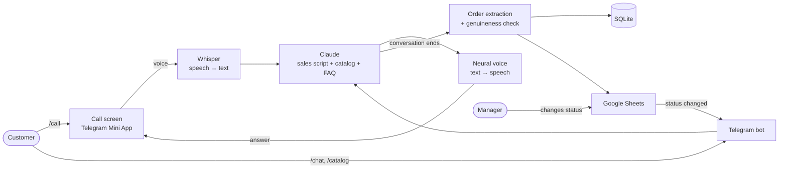

# AI Sales Voice Bot

**An AI sales manager that talks to customers by voice right inside Telegram, takes orders, and writes them into Google Sheets.**

🇺🇦 [Українська версія](README.uk.md)

Built as a real project for **Berry Farm** — a Ukrainian nursery of blueberry, hydrangea, kiwi and other seedlings. Customers open the bot, tap **📞 Call**, and talk to "Yagidka", a virtual manager who knows the whole catalog, answers growing questions, follows the company's sales script, and collects the order. Managers see every order in a Google Sheet and the customer is notified automatically when its status changes.

> This repository contains a **demo sample** of the catalog and FAQ. The full company data stays private.

<!-- Screenshots: add the files to docs/screenshots/ and uncomment this block
<p align="center">
  
  
  
</p>
<p align="center"></p>
-->

---

## What it does

| | |
|---|---|
| 🎙️ **Voice call in Telegram** | A call screen (Telegram Mini App) — the customer just talks. Speech is recognized, the AI answers with a natural Ukrainian voice. No phone line, no per-minute fees. |
| 🧠 **Sells like a trained manager** | Follows a step-by-step sales script: greeting → needs → product advice → quantity → delivery → phone → order summary. Quotes only real prices and stock from the catalog, answers care questions from the FAQ. |
| 💬 **Text chat** | The same AI manager in regular Telegram messages (`/chat`). |
| 🛍️ **Catalog with photos** | Categories → products → a card with photo, price, stock and key features, with "Order", "Ask" and "On the website" buttons. |
| 📊 **Orders in Google Sheets** | After each conversation the AI extracts name, phone, products, quantity, city and delivery, checks whether the order looks genuine, and adds a row to the table. |
| 🔔 **Status notifications** | A manager picks a status in the sheet (Confirmed / Shipped / Delivered…) — the customer gets a Telegram message within a minute. |
| 🛡️ **Abuse protection** | Daily limits per user (conversations, messages, call minutes) plus a total daily budget, so nobody can run up the AI bill. |
| ✏️ **No-code customization** | The script, all bot texts, statuses and the catalog live in CSV files — editable in Excel. |
| ☎️ **Real phone calls (optional)** | Twilio ConversationRelay integration for real-time calls to phone numbers, including automatic order-confirmation calls. |

## How it works



1. The customer speaks; the phrase ends automatically after a short pause.
2. **Whisper** (running locally) turns speech into text.
3. **Claude** answers as the company's manager, guided by the sales script, catalog and FAQ from CSV files.
4. A neural voice reads the answer back.
5. When the conversation ends, Claude extracts the order as structured data and it's saved to SQLite and Google Sheets.

## Tech stack

- **Python** · pyTelegramBotAPI · FastAPI
- **Claude API** (Anthropic) — conversation, structured order extraction
- **faster-whisper** — local speech recognition (free)
- **edge-tts** — Ukrainian neural voice (free)
- **Telegram Mini App** — call screen in plain HTML/JS (auto end-of-speech detection)
- **Google Sheets API** (gspread) — orders table with status dropdown
- **SQLite** — conversations, orders, usage limits
- **Twilio ConversationRelay** — optional real phone calls

The whole voice part is free and runs on your own computer/server — the only paid service is the AI model.

## Customize without code

| File | What it controls |
|---|---|
| `data/script.csv` | The sales script: steps, goals, example phrases |
| `data/texts.csv` | Every message and button text of the bot |
| `data/order_statuses.csv` | Order statuses and the message the customer gets for each |
| `data/catalog.csv` | Products, prices, stock, features, photos |
| `data/faq.csv` | Questions & answers the AI uses |
| `data/info.csv` | Company info: about, contacts, discounts, delivery |

`import_data.py` rebuilds the catalog, FAQ and company info from the company's database export and the live website (photos).

## Quick start

```bash
git clone https://github.com/Dymytrii524/ai-sales-voice-bot.git
cd ai-sales-voice-bot
python -m venv .venv
.venv\Scripts\activate          # Linux/macOS: source .venv/bin/activate
pip install -r requirements.txt
copy config.example.py config.py  # Linux/macOS: cp config.example.py config.py
```

Fill in `config.py`:

- `API_TOKEN` — Telegram bot token from [@BotFather](https://t.me/BotFather)
- `ANTHROPIC_API_KEY` — from [console.anthropic.com](https://console.anthropic.com)
- `PUBLIC_URL` — public HTTPS address for the call screen, e.g. `ngrok http 8000`
- `GOOGLE_SHEET_URL` + `google_credentials.json` — optional, a Google service account with access to the sheet

Run:

```bash
python main.py
```

Bot commands: `/start`, `/catalog`, `/about`, `/call`, `/chat`, `/end`.

## Project structure

```
main.py          Telegram bot: commands, catalog cards, chat, status notifications
assistant.py     AI core: prompts from CSV, Claude requests, order extraction, database
webcall.py       Voice call server: Whisper → Claude → voice
web/webcall.html Call screen (Telegram Mini App)
sheets.py        Google Sheets: orders & conversations tables
limits.py        Daily usage limits per user
phone.py         Optional real phone calls via Twilio
import_data.py   Builds catalog/FAQ/info CSVs from the company's data export
data/            Script, texts, statuses (+ demo catalog & FAQ in data/sample/)
```

## Want an AI manager for your business?

The same approach works for any business that sells by phone or messenger: online shops, clinics, real estate, services. The script, catalog and texts are just CSV files — the bot can be adapted to a new company in days, not months.

I'm open to consultations and custom development:

- ✉️ **Email:** [dymytriipryl@gmail.com](mailto:dymytriipryl@gmail.com)
- 💻 **GitHub:** [Dymytrii524](https://github.com/Dymytrii524)
