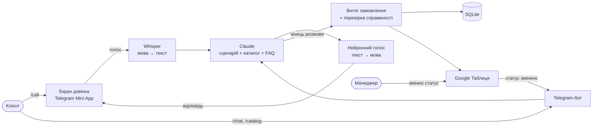

# AI Sales Voice Bot

**Віртуальний менеджер з продажу на основі ШІ: розмовляє з клієнтами голосом прямо в Telegram, приймає замовлення і записує їх у Google Таблицю.**

🇬🇧 [English version](README.md)

Створений як реальний проєкт для **Berry Farm**, українського розплідника саджанців лохини, гортензії, ківі та інших культур. Клієнт відкриває бота, натискає **📞 Подзвонити** і говорить з «Ягідкою». Це віртуальна менеджерка, яка знає весь каталог, відповідає на питання про вирощування, веде розмову за сценарієм продажу компанії й оформлює замовлення. Менеджери бачать кожне замовлення в Google Таблиці, а клієнт автоматично отримує повідомлення, коли статус замовлення змінюється.

> У репозиторії є лише **демо-зразок** каталогу та FAQ. Повні дані компанії залишаються приватними.

<!-- Скріншоти: додайте файли в docs/screenshots/ і розкоментуйте цей блок
<p align="center">
  
  
  
</p>
<p align="center"></p>
-->

---

## Можливості

| | |
|---|---|
| 🎙️ **Голосовий дзвінок у Telegram** | Екран дзвінка (Telegram Mini App), де клієнт просто говорить. Мова розпізнається, а ШІ відповідає природним українським голосом. Без телефонної лінії й без оплати за хвилини. |
| 🧠 **Продає, як навчений менеджер** | Веде розмову за сценарієм: привітання, потреба, підбір товару, кількість, доставка, телефон, підсумок замовлення. Називає лише справжні ціни й наявність з каталогу, а на питання про догляд відповідає за базою FAQ. |
| 💬 **Текстовий чат** | Той самий ШІ-менеджер у звичайних повідомленнях Telegram (`/chat`). |
| 🛍️ **Каталог з фото** | Категорії → товари → картка з фото, ціною, наявністю та характеристиками і кнопками «Замовити», «Запитати», «На сайті». |
| 📊 **Замовлення в Google Таблиці** | Після кожної розмови ШІ виписує ім'я, телефон, товари, кількість, місто й доставку, перевіряє, чи замовлення справжнє, і додає рядок у таблицю. |
| 🔔 **Сповіщення про статус** | Менеджер обирає статус у таблиці (Підтверджено / Відправлено / Доставлено…), і клієнт протягом хвилини отримує повідомлення в Telegram. |
| 🛡️ **Захист від зловживань** | Денні ліміти на кожного користувача (розмови, повідомлення, хвилини дзвінків) і загальний денний бюджет, щоб ніхто не «накрутив» рахунок за ШІ. |
| ✏️ **Налаштування без коду** | Сценарій, усі тексти бота, статуси й каталог зберігаються в CSV-файлах, які можна редагувати в Excel. |
| ☎️ **Справжні телефонні дзвінки (опційно)** | Інтеграція з Twilio ConversationRelay для живих дзвінків на номери телефонів, зокрема автоматичних дзвінків для підтвердження замовлення. |

## Як це працює



1. Клієнт говорить. Коли він робить коротку паузу, фраза автоматично завершується.
2. **Whisper** (працює локально) перетворює мову на текст.
3. **Claude** відповідає як менеджер компанії, спираючись на сценарій, каталог і FAQ з CSV-файлів.
4. Нейронний голос озвучує відповідь.
5. Коли розмова закінчується, Claude виписує замовлення у структурованому вигляді, і воно зберігається в SQLite та Google Таблиці.

## Технології

- **Python** · pyTelegramBotAPI · FastAPI
- **Claude API** (Anthropic): розмова і структурований витяг замовлення
- **faster-whisper**: локальне розпізнавання мови (безкоштовно)
- **edge-tts**: український нейронний голос (безкоштовно)
- **Telegram Mini App**: екран дзвінка на HTML/JS з автоматичним визначенням кінця фрази
- **Google Sheets API** (gspread): таблиця замовлень з випадним списком статусів
- **SQLite**: розмови, замовлення, ліміти
- **Twilio ConversationRelay**: справжні телефонні дзвінки (опційно)

Уся голосова частина безкоштовна і працює на вашому комп'ютері чи сервері. Платна лише модель ШІ.

## Налаштування без коду

| Файл | Що в ньому |
|---|---|
| `data/script.csv` | Сценарій продажу: кроки, цілі, приклади фраз |
| `data/texts.csv` | Усі повідомлення й тексти кнопок бота |
| `data/order_statuses.csv` | Статуси замовлень і повідомлення клієнту для кожного |
| `data/catalog.csv` | Товари, ціни, наявність, характеристики, фото |
| `data/faq.csv` | Питання й відповіді, на які спирається ШІ |
| `data/info.csv` | Про компанію: опис, контакти, знижки, доставка |

`import_data.py` створює каталог, FAQ та інформацію про компанію з експорту бази даних компанії та з живого сайту (фото).

## Швидкий старт

```bash
git clone https://github.com/Dymytrii524/ai-sales-voice-bot.git
cd ai-sales-voice-bot
python -m venv .venv
.venv\Scripts\activate          # Linux/macOS: source .venv/bin/activate
pip install -r requirements.txt
copy config.example.py config.py  # Linux/macOS: cp config.example.py config.py
```

Заповніть `config.py`:

- `API_TOKEN`: токен Telegram-бота від [@BotFather](https://t.me/BotFather)
- `ANTHROPIC_API_KEY`: ключ з [console.anthropic.com](https://console.anthropic.com)
- `PUBLIC_URL`: публічна HTTPS-адреса для екрана дзвінка, наприклад з `ngrok http 8000`
- `GOOGLE_SHEET_URL` + `google_credentials.json`: опційно, службовий акаунт Google з доступом до таблиці

Запуск:

```bash
python main.py
```

Команди бота: `/start`, `/catalog`, `/about`, `/call`, `/chat`, `/end`.

## Структура проєкту

```
main.py          Telegram-бот: команди, картки товарів, чат, сповіщення про статус
assistant.py     Ядро ШІ: промпти з CSV, запити до Claude, витяг замовлення, база
webcall.py       Сервер голосового дзвінка: Whisper → Claude → голос
web/webcall.html Екран дзвінка (Telegram Mini App)
sheets.py        Google Таблиця: замовлення і розмови
limits.py        Денні ліміти для кожного користувача
phone.py         Справжні телефонні дзвінки через Twilio (опційно)
import_data.py   Створює CSV каталогу/FAQ/інформації з експорту бази компанії
data/            Сценарій, тексти, статуси (+ демо-каталог і FAQ у data/sample/)
```

## Хочете такого ШІ-менеджера для свого бізнесу?

Цей підхід працює для будь-якого бізнесу, що продає телефоном чи в месенджерах: інтернет-магазинів, клінік, нерухомості, послуг. Сценарій, каталог і тексти — це звичайні CSV-файли, тож бота можна адаптувати під нову компанію за кілька днів, а не місяців.

Відкритий до консультацій та розробки під замовлення:

- ✉️ **Email:** [dymytriipryl@gmail.com](mailto:dymytriipryl@gmail.com)
- 💻 **GitHub:** [Dymytrii524](https://github.com/Dymytrii524)
